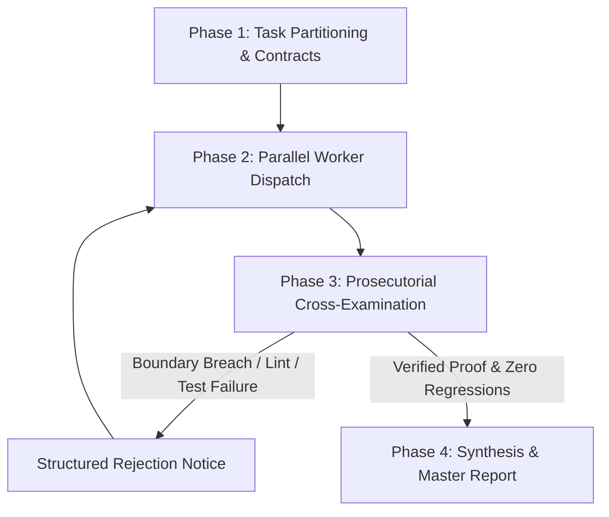

<div align="center">

#  Overwatcher

### Hierarchical Multi-Agent Supervisor & Adversarial Red-Team Cross-Examiner

[](https://python.org)
[](LICENSE)
[](tests/)
[](https://github.com/astral-sh/ruff)
[](#2-the-4-phase-supervisor-lifecycle)

<p align="center">
  <b>Enforce discipline, eliminate file collisions, and cross-examine subagent deliverables with deterministic proof before accepting completion.</b>
</p>

</div>

---

##  The Problem: "The Conversational Vibe-Check"

In standard autonomous multi-agent pipelines, agents frequently fall victim to conversational illusions:

- **Worker Drift**: Agents wander outside their assigned scope, modifying shared configurations and breaking downstream dependencies.
- **File Collisions**: Concurrent agents simultaneously edit overlapping files, creating unresolvable race conditions and merge anomalies.
- **Hallucinated Completions**: Agents summarize *"I fixed all bugs and verified tests"* while silently commenting out assertions, inserting trivial checks (`assert True`), or suppressing errors (`except: pass`).

**Overwatcher eliminates conversational complacency by acting as an adversarial prosecutor.** No claim is accepted without independent, reproducible terminal execution evidence.

---

### Unsupervised Agents vs. Overwatcher

| Dimension | Unsupervised Autonomous Agents | Overwatcher Supervised Pipeline |
| :--- | :--- | :--- |
| **Verification Basis** | Conversational summaries (*"All tests pass"*) | Prosecutorial AST diff analysis and CLI execution logs |
| **Workspace Boundaries** | Unconstrained file access across entire codebase | Strictly disjoint file contracts per subagent |
| **Error Handling Integrity** | Often introduces mock fallbacks and silent catches | Prohibits exception swallowing; flags and rejects slop |
| **Test Quality** | Vulnerable to trivial assertions (`assert True`) | Audits assertion substance and runs automated test suites |
| **Defect Remediation** | User must manually debug agent regressions | Automated Rejection Notice dispatched for worker rework |

---

##  1. The Overwatcher Iron Laws

```
+------------------------------------------------------------------------+
|                      THE OVERWATCHER IRON LAWS                         |
+------------------------------------------------------------------------+
| 1. ZERO TRUST IN CONVERSATIONAL CLAIMS ("Anti-Vibe-Check")             |
|    Never accept a worker's conversational summary. Every deliverable  |
|    is unverified until independently inspected and executed.           |
|                                                                        |
| 2. THE PROSECUTORIAL MINDSET                                           |
|    Act as an adversarial prosecutor seeking edge cases, race           |
|    conditions, memory leaks, and silent failure suppressions.         |
|                                                                        |
| 3. DOMAIN PARTITIONING & COLLISION PREVENTION                          |
|    Each worker receives a strictly disjoint file contract.            |
|    Workers must NEVER touch overlapping files.                         |
|                                                                        |
| 4. ITERATIVE REJECTION & RETRYING                                      |
|    Reject slop immediately with line-numbered proof. Never patch       |
|    worker mistakes yourself; force the worker to remediate.           |
+------------------------------------------------------------------------+
```

---

##  2. The 4-Phase Supervisor Lifecycle



### Phase 1: Task Partitioning & Contract Definition
1. Deconstruct the user's objective into **2 to 4 decoupled domains** (e.g., Auth/RBAC, Database/Pools, API Layer, Frontend UI).
2. Issue an explicit [Worker Contract](templates/worker_contract.md) defining:
   - **Authorized Targets**: Disjoint list of file paths.
   - **Acceptance Criteria**: Concrete functional deliverables and automated test targets.
   - **Forbidden Actions**: Zero tolerance for mock fallbacks, secret leaks, or API breakage.

### Phase 2: Parallel Worker Dispatch
1. Define specialized worker subagents with domain-specific system prompts.
2. Dispatch workers concurrently using background agent invocation tools.
3. Monitor worker lifecycles asynchronously without blocking or spinning in polling loops.

### Phase 3: Prosecutorial Cross-Examination (The Inquest)
When a worker signals completion, execute this 4-step cross-examination audit:

1. **Diff Scrutiny (`git diff` / AST inspection)**:
   - Verify that changes remain strictly within authorized contract boundaries.
   - Reject mock data, generic boilerplate, and unneeded dependencies.
2. **Deterministic Build Check**:
   - Execute project compilers and linters (`npm run build`, `tsc --noEmit`, `flake8`, `ruff`).
3. **Automated Test Execution**:
   - Run targeted test suites (`pytest tests/test_target.py -v`).
   - Confirm test assertions are genuine and verify edge conditions.
4. **Adjudication**:
   - **If defects exist**: Issue a structured `REJECTION NOTICE` detailing exact file paths, line numbers, terminal logs, and required corrective actions.
   - **If pristine**: Mark domain as `AUDITED & VERIFIED`.

### Phase 4: Synthesis & Final Master Report
Once all subagents have cleared cross-examination:
1. Run a global regression test suite across the entire workspace.
2. Compile a structured [Master Verification Report](templates/master_adjudication_report.md) with terminal execution logs.
3. Present the certified synthesis to the user.

---

##  3. Repository Architecture

```
overwatcher/
├── SKILL.md                          # Primary agent / skill specification
├── README.md                         # Architecture and documentation
├── LICENSE                           # MIT License
├── .gitignore                        # Standard ignores
│
├── assets/
│   └── icons/                        # Vector SVG interface icons
│       ├── logo.svg
│       ├── alert.svg
│       ├── shield.svg
│       ├── workflow.svg
│       ├── folder.svg
│       ├── terminal.svg
│       ├── file-text.svg
│       ├── pull-request.svg
│       └── scale.svg
│
├── templates/                        # Operational schemas and contracts
│   ├── worker_contract.md            # Domain partitioning contract template
│   ├── rejection_order.md            # Structured rejection notice template
│   └── master_adjudication_report.md # Final executive adjudication report
│
├── scripts/
│   └── cross_examiner.py             # CLI auditor for boundary & slop verification
│
├── tests/
│   └── test_cross_examiner.py        # Automated test suite for the cross examiner
│
└── examples/                         # Real-world reference implementations
    ├── sample_workflow.md            # End-to-end trace of a supervised refactor
    ├── sample_worker_contract.md     # Example of an instantiated worker contract
    ├── sample_rejection_order.md     # Example of an actual rejection notice
    └── sample_adjudication_report.md # Example of a green adjudication report
```

---

##  4. Installation & Agent Setup

### Agent Platform Compatibility

| Platform / Framework | Integration Type | Installation Target |
| :--- | :--- | :--- |
| **Antigravity / Google Deepmind** | Agent Skill | `.agents/skills/overwatcher/SKILL.md` |
| **Claude Code** | Custom Skill | `.claude/skills/overwatcher/SKILL.md` |
| **Cline / Roo-Code** | Rule / System Prompt | `.clinerules` or `.roomodes` |
| **Cursor** | Project Rule | `.cursor/rules/overwatcher.mdc` |
| **OpenHands** | Micro-Agent | `.openhands/microagents/overwatcher.md` |
| **LangGraph / CrewAI** | Supervisor Node | Python tool integration via `scripts/cross_examiner.py` |

### Installing as a Workspace Skill

To enable Overwatcher in your agent workspace:

```bash
# Create skill directory in your repository
mkdir -p .agents/skills/overwatcher

# Copy the skill specification
cp SKILL.md .agents/skills/overwatcher/SKILL.md
```

### Using the Standalone Cross-Examiner CLI

The repository includes a standalone Python utility (`scripts/cross_examiner.py`) that deterministically validates file boundaries, scans for banned patterns, and executes test suites:

```bash
# Run cross-examination on an active worker branch
python scripts/cross_examiner.py \
  --worker "auth_guard" \
  --domain "Authentication" \
  --allowed-files "src/core/auth.py" "tests/test_auth.py" \
  --verify-cmd "pytest tests/test_auth.py -v"
```

#### Running the Test Suite

```bash
python tests/test_cross_examiner.py
```

---

##  5. Communication & Rejection Protocols

### Worker Rejection Notice (Sent on Audit Failure)

```markdown
[OVERWATCHER REJECTION NOTICE]
Worker ID: {worker_name}
Target Domain: {domain_name}
Status: REJECTED — REWORK REQUIRED

1. Flaws Detected:
   - File: {file_path}:{line_number}
     Issue: {exact_description_of_defect_or_vulnerability}
     Evidence: {failing_test_output_or_diff_snippet}

2. Required Remediation:
   - {precise_remedy_instruction_1}
   - {precise_remedy_instruction_2}

Re-submit only after executing and passing: `{verification_command}`.
```

### Final Master Adjudication Report (Delivered to User)

```markdown
# Overwatcher Master Verification Report

## 1. Executive Summary
- Total Domains Audited: 2
- Subagents Deployed: 2
- Cross-Examination Iterations: 3
- Final Status: VERIFIED / ZERO REGRESSIONS

## 2. Worker Adjudication Breakdown
| Domain | Lead Subagent | Changes Audited | Status | Verification Evidence |
| :--- | :--- | :--- | :--- | :--- |
| Security / Auth | auth_guard | src/core/auth.py | PASSED | 8/8 tests passing |
| Database / Pools| db_reliability | src/core/db.py | PASSED | 14/14 tests passing |
```

---

##  6. Contributing

Contributions to improve verification heuristics, agent coordination protocols, and language-specific audit rules are welcome:

1. Fork the repository.
2. Create a feature branch (`git checkout -b feature/audit-rule`).
3. Ensure all tests pass (`python tests/test_cross_examiner.py`).
4. Submit a Pull Request with deterministic test verification.

---

##  7. License

This project is licensed under the [MIT License](LICENSE) (c) 2026 Fahad Bin Nasir.
