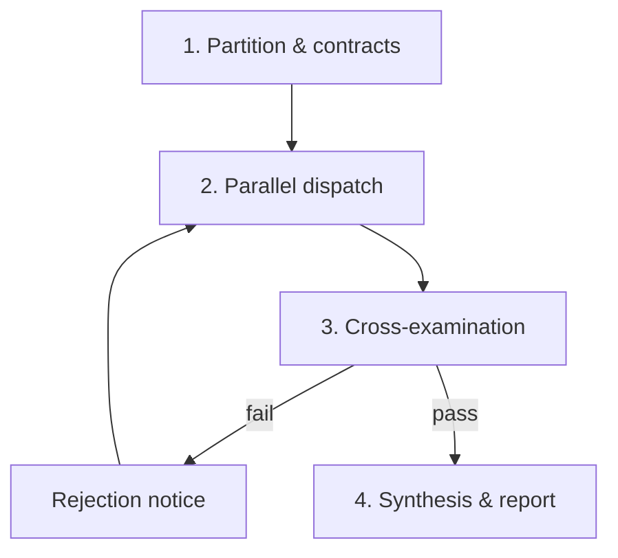

<div align="center">

#  Overwatcher

**A supervisor skill for multi-agent coding workflows. Splits work into disjoint file domains, then rejects worker output that breaks its contract or fails verification.**

[](LICENSE)
[](https://python.org)

[Quick start](#quick-start) · [How it works](#how-it-works) · [CLI](#cross-examiner-cli) · [Examples](#examples) · [Contributing](#contributing)

</div>

---

## Why

Unsupervised agent pipelines tend to fail in three ways:

- **Drift:** workers edit files outside their task and break shared config.
- **Collisions:** parallel workers edit the same files and create merge conflicts.
- **False "done":** workers report "all tests pass" after deleting assertions, adding `assert True`, or wrapping errors in `except: pass`.

Overwatcher counters each:

| Failure | Defense |
| :-- | :-- |
| Drift | Per-worker contract listing authorized files; out-of-scope diffs are rejected |
| Collisions | Contracts are disjoint; no two workers share a file |
| False "done" | Claims are ignored. The diff is scanned for known shortcuts and a verify command must exit 0 |

---

## Quick start

Install as a skill (Claude Code shown; other platforms [below](#platform-install-paths)):

```bash
mkdir -p .claude/skills/overwatcher
cp SKILL.md .claude/skills/overwatcher/SKILL.md
```

Then ask your agent:

> Use the overwatcher skill to refactor auth and the DB layer in parallel.

The agent acts as supervisor: it partitions the task, dispatches workers, audits each result, and returns a verification report.

---

## How it works



### Rules

1. **No trust in summaries.** Output is unverified until inspected and executed.
2. **Adversarial review.** Look for edge cases, race conditions, leaks, and swallowed errors.
3. **Disjoint ownership.** Workers never touch overlapping files.
4. **Reject, don't patch.** Send failures back with line-numbered proof. The supervisor only patches after repeated worker failures.

### Phases

**1. Partition.** Split the goal into 2–4 independent domains (e.g. Auth, DB, API, UI). Give each worker a [contract](templates/worker_contract.md):
- *Authorized targets:* exact file paths
- *Acceptance criteria:* deliverables and test targets
- *Forbidden:* mock fallbacks, leaked secrets, API breakage

**2. Dispatch.** Start workers concurrently with domain-specific prompts. Wait on completion signals; don't poll.

**3. Cross-examine.** When a worker reports done:
1. **Diff:** confirm changes stay inside the contract; reject mocks, boilerplate, and new dependencies. The CLI automates the file-boundary and pattern checks.
2. **Build:** run the project's compilers and linters (`tsc --noEmit`, `ruff`, `flake8`, ...).
3. **Test:** run the targeted tests; check that assertions are real.
4. **Verdict:** `REJECTION NOTICE` on any defect, otherwise `AUDITED & VERIFIED`.

**4. Synthesize.** Run the full regression suite, then produce the [master report](templates/master_adjudication_report.md) with logs.

---

## Cross-examiner CLI

`scripts/cross_examiner.py` is a standalone auditor. It needs only Python 3.8+ and git; no LLM.

```bash
python scripts/cross_examiner.py \
  --worker "auth_guard" \
  --domain "Authentication" \
  --allowed-files "src/core/auth.py" "tests/test_auth.py" \
  --verify-cmd "pytest tests/test_auth.py -v" \
  --repo-dir .
```

| Flag | Default | Purpose |
| :-- | :-- | :-- |
| `--worker` | `worker_subagent` | Worker ID, shown in the notice |
| `--domain` | `core` | Domain name, shown in the notice |
| `--allowed-files` | none | Glob patterns the worker may change. Boundary check is skipped if empty |
| `--verify-cmd` | none | Shell command that must exit 0 |
| `--repo-dir` | `.` | Git repository to audit |

**Checks**
1. **Boundaries:** files from `git status` must match an allowed glob (full path or basename, via `fnmatch`).
2. **Diff patterns:** added lines in `git diff HEAD` are regex-scanned for:
   - `except: pass`, `except Exception: pass`, empty `catch (...) {}`
   - `assert True`, `assert 1 == 1`, `expect(true).toBe(true)`
   - `debugger`, `breakpoint()`
3. **Verify command:** run in the repo; non-zero exit is a failure (last 10 output lines are reported).

**Exit codes:** `0` = `AUDITED & VERIFIED`, `1` = `REJECTED` (prints a rejection notice).

### Limitations
- Pattern matching is regex on diff text, not AST analysis. It catches common shortcuts, not all.
- Audits the **working tree** against `HEAD`. Uncommitted changes only.
- With parallel workers in one working tree, each audit sees the others' edits as violations. Give each worker its own `git worktree` or branch.
- Basename matching means `auth.py` also matches `other/dir/auth.py`. Use full-path globs.
- Untracked files count toward the boundary check, but their contents are not pattern-scanned.
- `--verify-cmd` runs with `shell=True`. Pass only trusted commands.
- Linters and builds run only if you put them in `--verify-cmd`.

Run its tests:

```bash
python tests/test_cross_examiner.py
```

---

## Platform install paths

| Platform | Target |
| :-- | :-- |
| Claude Code | `.claude/skills/overwatcher/SKILL.md` |
| Antigravity | `.agents/skills/overwatcher/SKILL.md` |
| Cursor | `.cursor/rules/overwatcher.mdc` |
| Cline / Roo-Code | `.clinerules` or `.roomodes` |
| OpenHands | `.openhands/microagents/overwatcher.md` |
| LangGraph / CrewAI | Call `scripts/cross_examiner.py` from a supervisor node |

---

## Message formats

<details>
<summary><b>Rejection notice</b> (sent to a worker on failure)</summary>

```markdown
[OVERWATCHER REJECTION NOTICE]
Worker ID: {worker_name}
Target Domain: {domain_name}
Status: REJECTED — REWORK REQUIRED

1. Flaws Detected:
   - File: {file_path}:{line_number}
     Issue: {defect}
     Evidence: {failing_test_output_or_diff_snippet}

2. Required Remediation:
   - {instruction}

Re-submit only after passing: `{verification_command}`.
```
</details>

<details>
<summary><b>Master report</b> (delivered to the user)</summary>

```markdown
# Overwatcher Master Verification Report

## Summary
- Domains audited: 2
- Workers: 2
- Cross-examination rounds: 3
- Status: VERIFIED / ZERO REGRESSIONS

## Breakdown
| Domain | Worker | Files | Status | Evidence |
| :-- | :-- | :-- | :-- | :-- |
| Auth | auth_guard | src/core/auth.py | PASSED | 8/8 tests |
| DB | db_reliability | src/core/db.py | PASSED | 14/14 tests |
```
</details>

---

## Examples

| File | Shows |
| :-- | :-- |
| [sample_workflow.md](examples/sample_workflow.md) | End-to-end supervised refactor |
| [sample_worker_contract.md](examples/sample_worker_contract.md) | A filled-in contract |
| [sample_rejection_order.md](examples/sample_rejection_order.md) | A real rejection notice |
| [sample_adjudication_report.md](examples/sample_adjudication_report.md) | A passing report |

---

## Repository layout

```
SKILL.md              # skill spec
templates/            # contract, rejection, report templates
scripts/              # cross_examiner.py
tests/                # cross_examiner tests
examples/             # worked examples
assets/icons/         # logo
```

---

## Contributing

New audit rules, heuristics, and language support are welcome.

1. Fork and branch: `git checkout -b feature/audit-rule`
2. Add tests; run `python tests/test_cross_examiner.py`
3. Open a PR

---

## License

[MIT](LICENSE) © 2026 Fahad Bin Nasir
