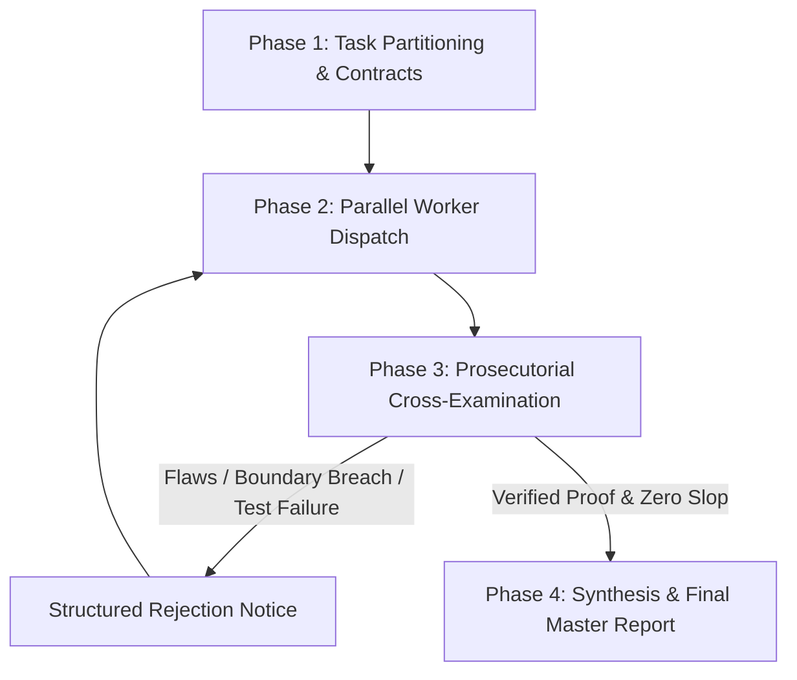

# 👁️ Overwatcher

[](LICENSE)
[](tests/)
[](#2-the-4-phase-supervisor-lifecycle)
[](#1-the-overwatcher-iron-laws)

> **Autonomous Hierarchical Supervisor, Orchestrator, and Red-Team Cross-Examiner for Multi-Agent AI Pipelines.**

Overwatcher acts as a **Principal Staff Architect** and **Adversarial Red-Team Auditor**. It coordinates specialized worker subagents, enforces strict domain isolation to eliminate file collisions, and ruthlessly cross-examines all deliverables with deterministic proof (diff inspections, AST validation, compiler builds, and genuine test suites) before anything is approved.

---

## ⚡ The Problem: "The Conversational Vibe-Check"

In modern AI agent workflows:
- **Worker Drift**: Agents wander outside their designated areas, modifying unrelated files and breaking dependencies.
- **File Collisions**: Multiple parallel agents touch the same files simultaneously, generating race conditions and merge chaos.
- **Hallucinated Completions**: Agents frequently report *"I fixed all bugs and tests pass!"* while tests are commented out, assertions are trivial (`assert True`), or exceptions are silently swallowed (`except: pass`).

**Overwatcher eliminates this by acting as an adversarial prosecutor.** No conversational claim is ever accepted without deterministic, reproducible terminal evidence.

---

## 🏛️ 1. The Overwatcher Iron Laws

```
┌────────────────────────────────────────────────────────────────────────┐
│                      THE OVERWATCHER IRON LAWS                        │
├────────────────────────────────────────────────────────────────────────┤
│ 1. ZERO TRUST IN CONVERSATIONAL CLAIMS ("Anti-Vibe-Check")             │
│    Never accept a worker's conversational summary. Every change is    │
│    unverified until independently inspected and executed.              │
│                                                                        │
│ 2. THE PROSECUTORIAL MINDSET                                           │
│    Act as an adversarial prosecutor looking for holes, regressions,   │
│    leaked secrets, and silent error swallowing.                        │
│                                                                        │
│ 3. DOMAIN PARTITIONING & COLLISION PREVENTION                          │
│    Every worker receives a strictly disjoint file contract.           │
│    Workers must NEVER touch overlapping files.                         │
│                                                                        │
│ 4. ITERATIVE REJECTION & RETRYING                                      │
│    Reject slop instantly with line-numbered proof. Never patch worker │
│    mistakes yourself; force the worker to remediate and verify.       │
└────────────────────────────────────────────────────────────────────────┘
```

---

## 🔄 2. The 4-Phase Supervisor Lifecycle



### Phase 1: Task Partitioning & Contract Definition
- Deconstruct the objective into **2 to 4 decoupled domains** (e.g., Auth/Security, Database/Connection Pools, UI/Component Trees).
- Issue an explicit [Worker Contract](templates/worker_contract.md) with strictly disjoint write targets, forbidden actions, and non-negotiable acceptance criteria.

### Phase 2: Parallel Worker Dispatch
- Dispatch specialized worker subagents concurrently.
- Monitor execution asynchronously without blocking or spinning in tight polling loops.

### Phase 3: Prosecutorial Cross-Examination (The Inquest)
When a worker signals completion, Overwatcher performs a 4-step cross-examination:
1. **Diff Scrutiny (`git diff` & AST inspection)**: Inspect unauthorized file modifications, edge cases, and banned shortcuts.
2. **Deterministic Build Check**: Run linters and type checkers (`tsc --noEmit`, `ruff`, `flake8`, `npm run build`).
3. **Automated Test Execution**: Execute targeted test suites (`pytest tests/test_target.py -v`). Inspect test assertions to ensure they are non-trivial.
4. **Adjudication**:
   - **Flaws Detected**: Issue an immediate structured `[OVERWATCHER REJECTION NOTICE]` with line numbers and required remediation instructions.
   - **Pristine**: Mark domain as `AUDITED & VERIFIED`.

### Phase 4: Synthesis & Final Master Report
- Execute workspace-wide global regression tests.
- Deliver an executive [Master Verification Report](templates/master_adjudication_report.md) with verified terminal evidence.

---

## 📂 Repository Structure

```
overwatcher/
├── SKILL.md                          # Primary agent / skill specification
├── README.md                         # Architecture and documentation
├── LICENSE                           # MIT License
├── .gitignore                        # Standard ignores
│
├── templates/                        # Operational schemas and contracts
│   ├── worker_contract.md            # Domain partitioning contract template
│   ├── rejection_order.md            # Structured rejection notice template
│   └── master_adjudication_report.md # Final executive adjudication report
│
├── scripts/
│   └── cross_examiner.py             # CLI auditor for boundary & slop verification
│
├── tests/
│   └── test_cross_examiner.py        # Automated test suite for the cross examiner
│
└── examples/                         # Real-world reference implementations
    ├── sample_workflow.md            # End-to-end trace of a supervised refactor
    ├── sample_worker_contract.md     # Example of an instantiated worker contract
    ├── sample_rejection_order.md     # Example of an actual rejection notice
    └── sample_adjudication_report.md # Example of a green adjudication report
```

---

## 🛠️ Installation & Setup

### 1. As an Agent Skill (Antigravity, Claude Code, Cline, OpenHands)
Clone or copy `SKILL.md` into your agent's skills directory:

```bash
# For Antigravity / Claude Code / Cline workspace:
mkdir -p .agents/skills/overwatcher
cp SKILL.md .agents/skills/overwatcher/SKILL.md
```

### 2. Using the Automated Cross-Examiner CLI
The repository includes a standalone Python CLI (`scripts/cross_examiner.py`) that deterministically audits modified files against contract boundaries and detects AI anti-patterns:

```bash
# Audit a worker's modifications against allowed file boundaries
python scripts/cross_examiner.py \
  --worker "auth_guard" \
  --domain "Authentication" \
  --allowed-files "src/core/auth.py" "tests/test_auth.py" \
  --verify-cmd "pytest tests/test_auth.py -v"
```

#### Running Tests
```bash
python tests/test_cross_examiner.py
```

---

## 📑 Communication Templates

### Worker Rejection Notice
```markdown
[OVERWATCHER REJECTION NOTICE]
Worker ID: {worker_name}
Target Domain: {domain_name}
Status: REJECTED — REWORK REQUIRED

1. Flaws Detected:
   - File: {file_path}:{line_number}
     Issue: {exact_description_of_defect_or_vulnerability}
     Evidence: {failing_test_output_or_diff_snippet}

2. Required Remediation:
   - {precise_remedy_instruction_1}
   - {precise_remedy_instruction_2}

Re-submit only after executing and passing: `{verification_command}`.
```

### Final Master Adjudication Report
```markdown
# Overwatcher Master Verification Report

## 1. Executive Summary
- Total Domains Audited: 2
- Subagents Deployed: 2
- Cross-Examination Iterations: 3
- Final Status: VERIFIED / ZERO REGRESSIONS

## 2. Worker Adjudication Breakdown
| Domain | Lead Subagent | Changes Audited | Status | Verification Evidence |
| :--- | :--- | :--- | :--- | :--- |
| Security / Auth | auth_guard | src/core/auth.py | PASSED | 8/8 tests passing |
| Database / Pools| db_reliability | src/core/db.py | PASSED | 14/14 tests passing |
```

---

## 🤝 Contributing

Contributions, issues, and feature requests are welcome!
Feel free to open an issue or submit a pull request.

---

## 📄 License

This project is licensed under the [MIT License](LICENSE) © 2026 Fahad Bin Nasir.
